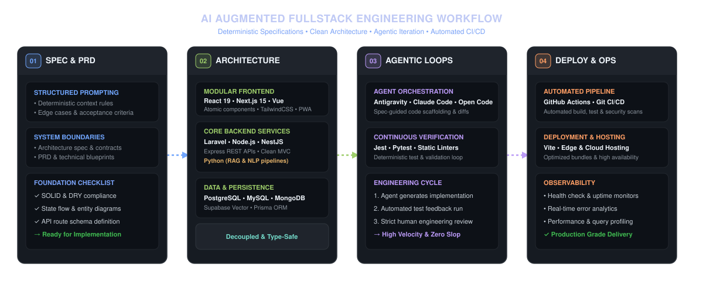

# M. Vicky Mosafan
### Full-Stack Developer & Prompt Engineer | AI-Augmented Engineer

---

## Chapter 01: The Paradigm

> **"Engineering is not replaced by AI. It is amplified by it."**

I am a **Full-Stack Developer & Prompt Engineer | AI-Augmented Engineer**. I leverage AI across the entire software development lifecycle to improve speed, quality, and decision-making, from planning and architecture to implementation and deployment.

Before writing a single line of implementation, I create structured PRDs, technical documentation, and system designs to ensure a strong foundation before development. During execution, I use AI to accelerate coding, analyze issues, enhance documentation, and streamline testing and iteration.

My core discipline stays grounded in software craftsmanship:
* **Architectural Principles**: Strict adherence to SOLID, DRY, and KISS for clean, modular, and scalable software architecture.
* **Backend Architecture**: API security, database performance, microservices, and reliable data pipelines.
* **Frontend Engineering**: Reusable component design, atomic design systems, and responsive performance.
* **Core Vision**: Combining rigorous engineering practices with AI to deliver efficient, secure, and future-ready applications.

---

## Chapter 02: The Architectural Blueprint

To achieve high velocity without technical debt, every build follows an AI-augmented engineering pipeline:

---

## Chapter 03: The Artifacts (Flagship Systems)

Here is how this methodology translates into real, high-impact production applications with live telemetry:

### Civic & Institutional Platforms

#### 1. [system-pemerintahan](https://github.com/vickyymosafan/system-pemerintahan)

<table border="0">
<tr>
<td width="48%" align="center" valign="middle">

</td>
<td width="52%" valign="middle">

* **The Challenge**: Managing complex civic document workflows and public government announcements with high security and reliability.
* **Engineering**: Monolithic yet decoupled architecture utilizing Laravel with Inertia.js and React TypeScript for seamless single-page application performance without API boilerplate.
* **Stack**:     
* **Key Features**: Type-safe Inertia routing, role-based access control, responsive public portal.

</td>
</tr>
</table>

---

### Retrieval-Augmented Generation (RAG) & Intelligent Agents

#### 2. [FullStack_ai-smartchat](https://github.com/vickyymosafan/FullStack_ai-smartchat)

<table border="0">
<tr>
<td width="48%" align="center" valign="middle">

</td>
<td width="52%" valign="middle">

* **The Challenge**: Delivering instant, accurate university intelligence for Universitas Muhammadiyah Jember.
* **Engineering**: Retrieval-Augmented Generation (RAG) orchestrating automated n8n reasoning workflows, Supabase Vector similarity search, voice speech recognition, and an installable PWA for campus mobile access.
* **Stack**:      
* **Key Features**: Automated n8n reasoning workflows, real-time RAG context retrieval, Web Speech API integration, offline-capable PWA.

</td>
</tr>
</table>

---

#### 3. [FE_Beyond-RAG-Artificial-Super-Intelligence](https://github.com/vickyymosafan/FE_Beyond-RAG-Artificial-Super-Intelligence) & [BE_Beyond-RAG-Artificial-Super-Intelligence](https://github.com/vickyymosafan/BE_Beyond-RAG-Artificial-Super-Intelligence)

<table border="0">
<tr>
<td width="50%" align="center" valign="middle">

</td>
<td width="50%" align="center" valign="middle">

</td>
</tr>
</table>

* **The Challenge**: Delivering high-accuracy institutional intelligence with multi-turn conversational context, vector similarity retrieval, in-memory document parsing (PDF/DOCX), and ultra-low latency edge execution.
* **Engineering**: Decoupled fullstack RAG pipeline pairing a Next.js App Router PWA frontend with a Cloudflare Workers backend powered by Hono, Neon Serverless PostgreSQL, and Zod runtime validation.
* **Stack**:      
* **Key Features**: Edge serverless RAG API, in-memory document chunking, multi-turn vector context, voice speech recognition, and cross-platform installable PWA.

---

### Intelligent Financial & Client-Side Systems

#### 4. [auto-analysis-market](https://github.com/vickyymosafan/auto-analysis-market)

<table border="0">
<tr>
<td width="48%" align="center" valign="middle">

</td>
<td width="52%" valign="middle">

* **The Challenge**: Eliminating latency and emotional bias in technical market chart analysis.
* **Engineering**: Multimodal vision reasoning using Google Gemini API to scan candlestick charts, calculate technical indicators, and produce structured trade setups.
* **Stack**:     
* **Key Features**: Multimodal chart recognition, automated risk-to-reward calculation, zero server latency.

</td>
</tr>
</table>

---

#### 5. [instagram-unfollow-checker](https://github.com/vickyymosafan/instagram-unfollow-checker) • 

<table border="0">
<tr>
<td width="48%" align="center" valign="middle">

</td>
<td width="52%" valign="middle">

* **The Challenge**: Analyzing social graphs without compromising user credentials or privacy.
* **Engineering**: 100% client-side stream parsing of data packages entirely inside browser memory, ensuring zero data leaves the client.
* **Stack**:    
* **Key Features**: Zero credential exposure, client-side ZIP/JSON stream processing, high memory efficiency.

</td>
</tr>
</table>

---

#### 6. [imageconverter](https://github.com/vickyymosafan/imageconverter)

<table border="0">
<tr>
<td width="48%" align="center" valign="middle">

</td>
<td width="52%" valign="middle">

* **The Challenge**: Fast, lossless image batch conversion without third-party server upload limits.
* **Engineering**: In-browser Canvas API processing supporting WebP, PNG, JPEG, GIF, and BMP with real-time compression preview.
* **Stack**:     
* **Key Features**: Drag-and-drop batch queue, real-time compression preview, client-side memory safety.

</td>
</tr>
</table>

---

### Healthcare & Core Backend Services

#### 7. [fe_posyandu-digital](https://github.com/vickyymosafan/fe_posyandu-digital) & [be_posyandu-digital](https://github.com/vickyymosafan/be_posyandu-digital)

<table border="0">
<tr>
<td width="50%" align="center" valign="middle">

</td>
<td width="50%" align="center" valign="middle">

</td>
</tr>
</table>

* **The Challenge**: Modernizing health index records for elderly community care (Posyandu Lansia).
* **Engineering**: QR-code patient verification with normalized PostgreSQL relational schemas via Prisma ORM and Next.js 14 dashboards.
* **Stack**:     
* **Key Features**: QR-code patient check-in, automated health parameter reports, normalized schema.

---

## Chapter 04: The Technical Arsenal

 

Organized across key architectural domains:

| Architectural Domain | Core Technologies & Tooling |
| :--- | :--- |
| **Languages** |        |
| **Frontend Ecosystem** |       |
| **Backend & Microservices** |      |
| **Databases & Storage** |      |
| **AI Augmented Tooling** |     |
| **DevOps & Infrastructure** |    |

---

## Chapter 05: Continuous Telemetry & Live Activity

<table border="0">
<tr>
<td align="center" width="50%">

</td>
<td align="center" width="50%">

</td>
</tr>
<tr>
<td align="center" width="50%">

</td>
<td align="center" width="50%">

</td>
</tr>
</table>

 

<picture>
  <source media="(prefers-color-scheme: dark)" srcset="https://raw.githubusercontent.com/vickyymosafan/vickyymosafan/output/pacman-contribution-graph-dark.svg">
  <source media="(prefers-color-scheme: light)" srcset="https://raw.githubusercontent.com/vickyymosafan/vickyymosafan/output/pacman-contribution-graph.svg">
  
</picture>

 

