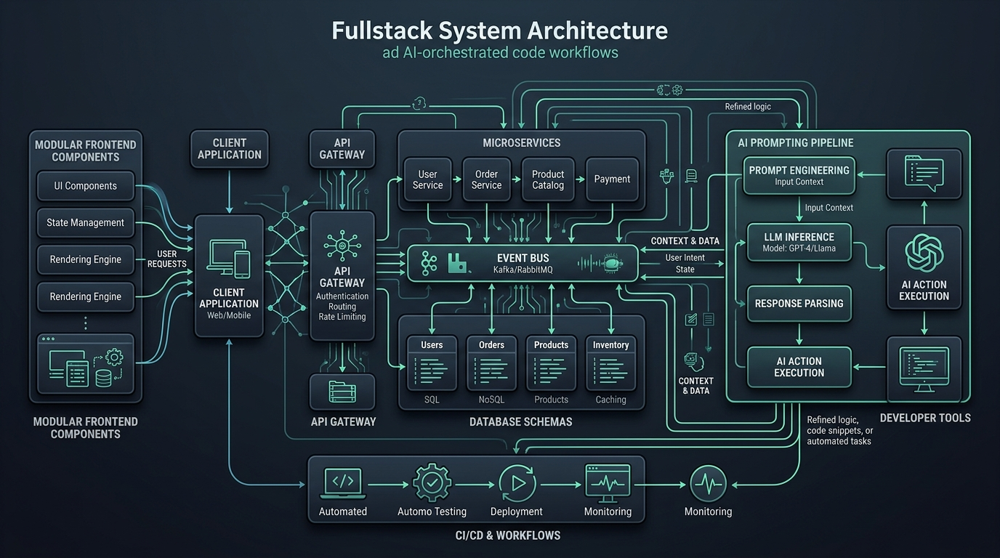

<div align="center">


<br/>
<br/>

[](https://github.com/vickyymosafan)
[](https://github.com/vickyymosafan)
[](https://github.com/vickyymosafan)
[](https://github.com/vickyymosafan)

</div>

---

### ⚡ System Architecture & AI Augmented Engineering

<div align="center">



</div>

> **I am a Fullstack Developer & Prompt Engineer specializing in AI Augmented Engineering.**

I leverage AI across the entire software development lifecycle to improve speed, quality, and decision-making, from planning and architecture to implementation and deployment.

I create structured PRDs, technical documentation, and system designs to ensure a strong foundation before development, and I use AI to accelerate coding, analyze issues, enhance documentation, and streamline testing and iteration.

* **Engineering Practices**: SOLID, DRY, and KISS principles for clean, modular, and scalable software architecture.
* **Backend Architecture**: API security, database performance, microservices, and reliable data pipelines.
* **Frontend Engineering**: Reusable component design, atomic design systems, and responsive performance.
* **Vision**: Passionate about combining rigorous software engineering with AI to deliver efficient, secure, and future-ready applications.

---

### 🚀 Flagship Applications & Engineering Solutions

<table>
<tr>
<td width="50%" valign="top">

#### 🏛️ [system-pemerintahan](https://github.com/vickyymosafan/system-pemerintahan)
Modern e-government platform designed for civic document submission and public announcements. Built with a monolithic yet decoupled structure ensuring data integrity and frictionless UX.

* **Stack**: `Laravel` • `Inertia.js` • `React` • `TypeScript` • `MySQL`
* **Highlights**: Type-safe Inertia routing, role-based access control, responsive public portal.

</td>
<td width="50%" valign="top">

#### 🤖 [FullStack_ai-smartchat](https://github.com/vickyymosafan/FullStack_ai-smartchat)
Intelligent campus assistant for Universitas Muhammadiyah Jember featuring Retrieval-Augmented Generation (RAG) and instant onboarding.

* **Stack**: `Next.js` • `TypeScript` • `Supabase Vector` • `Radix UI` • `PWA`
* **Highlights**: Real-time RAG context retrieval, Web Speech API integration, offline-capable PWA.

</td>
</tr>

<tr>
<td width="50%" valign="top">

#### 📈 [auto-analysis-market](https://github.com/vickyymosafan/auto-analysis-market)
Financial analysis application leveraging Google Gemini vision models to interpret candlestick chart patterns and provide actionable technical strategies.

* **Stack**: `React` • `Vite` • `TypeScript` • `Google Gemini API` • `TailwindCSS`
* **Highlights**: Multimodal chart recognition, automated risk-to-reward calculation, zero server latency.

</td>
<td width="50%" valign="top">

#### 🔍 [unfollowscan](https://github.com/vickyymosafan/unfollowscan)
Privacy-first Instagram follower analytics application. All parsing, graph comparison, and mutual friend detection happen 100% client-side in the user's browser.

* **Stack**: `Next.js` • `TypeScript` • `React` • `TailwindCSS`
* **Highlights**: Zero credential exposure, client-side ZIP/JSON stream processing, high memory efficiency.

</td>
</tr>

<tr>
<td width="50%" valign="top">

#### 🖼️ [imageconverter](https://github.com/vickyymosafan/imageconverter)
Client-side image conversion utility delivering high-definition conversions across WebP, PNG, JPEG, GIF, and BMP formats without uploading sensitive files to external servers.

* **Stack**: `React` • `Vite` • `TypeScript` • `Canvas API` • `PWA`
* **Highlights**: Drag-and-drop batch queue, real-time compression preview, client-side memory safety.

</td>
<td width="50%" valign="top">

#### 🏥 [fe_pencatatan-posyandu](https://github.com/vickyymosafan/fe_pencatatan-posyandu) & [be](https://github.com/vickyymosafan/be_pencatatan-posyandu)
Integrated digital healthcare records system for elderly health monitoring (Posyandu Lansia) with automated health index calculations and QR verification.

* **Stack**: `Next.js 14` • `Express` • `Prisma ORM` • `PostgreSQL` • `TypeScript`
* **Highlights**: QR-code patient check-in, automated health parameter reports, normalized database schema.

</td>
</tr>
</table>

<details>
<summary><b>📂 Explore More Specialized Projects</b></summary>
<br/>

* **[antosa-architect](https://github.com/vickyymosafan/antosa-architect)**: Architecture firm portfolio & client consultation portal developed with a custom PHP MVC architecture.
* **[BE_playlist-downloader](https://github.com/vickyymosafan/BE_playlist-downloader)**: Media conversion service powered by Express, yt-dlp, and FFmpeg for high-throughput batch downloads.
* **[BE_POS-PT.IndoAugust](https://github.com/vickyymosafan/BE_POS-PT.IndoAugust)**: Enterprise Point of Sale backend built with NestJS, TypeScript, and clean hexagonal architecture.

</details>

---

### 🛠️ Technical Arsenal

<div align="center">

| Domain | Technologies & Tooling |
|:---|:---|
| **Core Languages** |      |
| **Frontend Frameworks** |      |
| **Backend & APIs** |      |
| **Databases & Storage** |      |
| **AI Tooling & Environments** |     |
| **DevOps & Workflow** |     |

</div>

---

### 📊 Live Telemetry & GitHub Performance

<div align="center">

<table>
<tr>
<td width="50%" align="center">


</td>
<td width="50%" align="center">


</td>
</tr>
<tr>
<td width="50%" align="center">


</td>
<td width="50%" align="center">


</td>
</tr>
</table>

<br/>

<picture>
  <source media="(prefers-color-scheme: dark)" srcset="https://raw.githubusercontent.com/vickyymosafan/vickyymosafan/output/pacman-contribution-graph-dark.svg">
  <source media="(prefers-color-scheme: light)" srcset="https://raw.githubusercontent.com/vickyymosafan/vickyymosafan/output/pacman-contribution-graph.svg">
  
</picture>

<br/>


</div>

---

<div align="center">

```typescript
const vickyMosafan: DeveloperProfile = {
  name: "M. Vicky Mosafan",
  role: "Fullstack Developer & Prompt Engineer",
  specialization: "AI Augmented Engineering",
  architecturePrinciples: ["SOLID", "DRY", "KISS", "Modular Design"],
  currentMission: "Delivering efficient, secure, and future-ready applications across the full SDLC",
  status: "Open for collaboration & architectural challenges"
};
```

[](https://github.com/vickyymosafan)
[](mailto:vickymosafan@gmail.com)

</div>